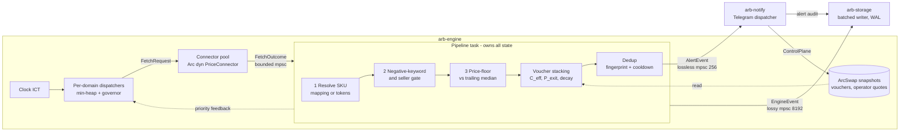

# Phase 2 — Architecture & Workspace Blueprint

## 1. Workspace

```
Cargo.toml                 workspace, pinned dependency floors, lint policy
config/
  engine.toml              -> arb_core::EngineConfig
  skus.toml                -> arb_core::SkuCatalog
  vouchers_11_11.toml      -> arb_core::VoucherBook
crates/
  arb-core/                FROZEN contracts (types, integer money, ports, errors)
  arb-connectors/          S-1  HTTP middleware, JSON-LD extractor, retailer + API adapters
  arb-engine/              O-1  scheduler, resolution/filter, pricing, dedup, Pipeline
  arb-storage/             S-2  SQLite (WAL) price history, alert audit, overrides
  arb-notify/              S-2  teloxide dispatcher, alert cards, commands
  arb-cli/                 S-2  binary: config, wiring, supervision, shutdown
                           O-2  `replay` + stress tests (separate files, see Phase 3)
docs/  prompts/
```

Dependency direction (no cycles, nothing depends on `arb-cli`):

```
arb-core  <-  arb-connectors
arb-core  <-  arb-engine
arb-core  <-  arb-storage
arb-core  <-  arb-notify
all five  <-  arb-cli
```

`arb-engine` does **not** depend on `arb-connectors`, `arb-storage` or `arb-notify`. It
sees connectors as `Arc<dyn PriceConnector>` and talks to the outside through channels and
`ControlPlane`. That is what lets O-1, S-1 and S-2 work in parallel.

## 2. Data flow



ASCII equivalent:

```
Clock ─► Dispatcher(domain A) ─┐                       ┌─► alert bus (lossless) ─► Telegram
         Dispatcher(domain B) ─┼─► connectors ─► inbox ─► PIPELINE ─┤
         Dispatcher(domain …) ─┘      (bounded mpsc)   │  resolve    └─► event bus (lossy) ──► SQLite writer
              ▲                                        │  filter
              └────────── priority feedback ───────────┤  evaluate
   Telegram commands ─► ControlPlane ─► ArcSwap ──────►│  dedup
```

## 3. Task inventory

| Task | Count | Owns | Blocks on |
|---|---|---|---|
| Domain dispatcher | 1 per enabled rate-limit domain | job heap, limiter, semaphore | limiter, clock |
| Fetch | ≤ `max_concurrency` per source | nothing | network (timeout-bounded) |
| Pipeline | 1 | medians, best-spread table, dedup cache | inbox, alert bus when full |
| Storage writer | 1 | SQLite write connection | event bus, disk |
| Telegram dispatcher | 1 (+ teloxide update listener) | bot | alert bus, Bot API |
| Config watcher | 1 | file watch | fs events |
| Supervisor (`arb-cli`) | 1 | `JoinHandle`s, `CancellationToken` | signals |

Rules: no `std::sync::Mutex` held across `.await`; no unbounded channels; every spawned
task's `JoinHandle` is owned by the supervisor; CPU-heavy parsing uses `spawn_blocking`.

## 4. `arb-core` contracts

The code in `crates/arb-core` **is** the specification; this section is an index.

| Type / trait | File | Notes |
|---|---|---|
| `VndAmount`, `Bps`, `SignedBps`, `Rounding` | `money.rs` | Checked integer math; `mul_bps` requires a rounding mode. |
| `SkuId`, `ColorId`, `SourceId`, `SourceKind` | `ids.rs` | Slugs validated on construction and on deserialize. |
| `CanonicalSku`, `ColorVariant`, `SourceMapping`, `BuybackQuote`, `SkuCatalog` | `sku.rs` | `SkuCatalog::validate()` enforces referential integrity. |
| `RawMarketListing`, `Availability`, `SellerTier`, `VatInvoiceStatus`, `FetchRequest`, `FetchOutcome` | `listing.rs` | Connectors report facts; `check_invariants()` is the connector-side guard. |
| `VoucherRule`, `DiscountKind`, `VoucherLayer`, `VoucherBook` | `voucher.rs` | `discount_on()` is the single definition of a rule's discount. |
| `CostBreakdown::build`, `ExitBreakdown::build`, `net_profit_and_roi` | `opportunity.rs` | The pricing identities. Engine selects inputs; these combine them. |
| `ArbitrageOpportunity`, `AlertEvent`, `EngineEvent`, `PriceTick`, `RejectReason`, `RiskFlag` | `opportunity.rs` | |
| `EngineConfig` and sub-configs, `Thresholds::classify`, `FlashWindow::contains`, `DecayConfig::haircut_for` | `config.rs` | |
| `PriceConnector`, `ControlPlane`, `Clock`, `HealthReport` | `ports.rs` | Dyn-compatible, `BoxFuture`. |
| `ArbError`, `ParseStage` | `error.rs` | `is_retryable()`, `trips_circuit()`, `kind()`. |
| `ICT`, `SCHEMA_VERSION` | `lib.rs` | |

Pricing identities (all integer, rounding always against us):

```
C_eff  = listed − shop_voucher − platform_voucher − payment_discount
         − expected_cashback + max(shipping_gross − shipping_voucher, 0)

adj    = floor(quote × colour_liquidity) − (invoice ? 0 : no_invoice_penalty)
P_exit = adj − ceil(adj × decay_haircut)

net    = P_exit − C_eff
roi    = floor(net / C_eff)            in bps
```

## 5. Pinned public facades

These signatures cross agent boundaries. They are binding exactly as written; anything
else in a crate's API is the owner's choice.

### 5.1 `arb-connectors` (S-1 provides, S-2 consumes)

```rust
#[derive(Clone, Default)]
pub struct Secrets {
    pub shopee_app_id: Option<String>,
    pub shopee_app_secret: Option<String>,
    pub lazada_app_key: Option<String>,
    pub lazada_app_secret: Option<String>,
    pub lazada_user_token: Option<String>,
}

impl Secrets {
    /// Reads ARB_SHOPEE_APP_ID, ARB_SHOPEE_APP_SECRET, ARB_LAZADA_APP_KEY,
    /// ARB_LAZADA_APP_SECRET, ARB_LAZADA_USER_TOKEN. Missing variables are `None`.
    pub fn from_env() -> Self;
}
// `Debug` for `Secrets` must be hand-written and redact every value.

/// One connector per *enabled* `[[source]]`. An enabled marketplace source whose
/// credentials are missing is an `ArbError::Config`, not a silent skip.
pub fn build_connectors(
    config: &arb_core::EngineConfig,
    secrets: &Secrets,
    clock: std::sync::Arc<dyn arb_core::Clock>,
) -> Result<Vec<std::sync::Arc<dyn arb_core::PriceConnector>>, arb_core::ArbError>;
```

### 5.2 `arb-engine` (O-1 provides; S-2 and O-2 consume)

```rust
pub struct EngineDeps {
    pub config: arb_core::EngineConfig,
    pub catalog: arb_core::SkuCatalog,
    pub vouchers: arb_core::VoucherBook,
    /// Operator quotes restored from storage; they supersede catalog quotes.
    pub operator_quotes: Vec<arb_core::BuybackQuote>,
    pub connectors: Vec<std::sync::Arc<dyn arb_core::PriceConnector>>,
    pub clock: std::sync::Arc<dyn arb_core::Clock>,
}

pub struct EngineHandle {
    pub alerts: tokio::sync::mpsc::Receiver<arb_core::AlertEvent>,
    pub events: tokio::sync::mpsc::Receiver<arb_core::EngineEvent>,
    pub control: std::sync::Arc<dyn arb_core::ControlPlane>,
    /// Resolves when the engine has fully drained after `shutdown` is cancelled.
    pub task: tokio::task::JoinHandle<Result<(), arb_core::ArbError>>,
}

/// Validates all three configs, then starts dispatchers and the pipeline task.
pub fn spawn(
    deps: EngineDeps,
    shutdown: tokio_util::sync::CancellationToken,
) -> Result<EngineHandle, arb_core::ArbError>;

/// Synchronous, deterministic core: no I/O, no clock reads, no randomness.
/// The async engine and the replay simulator both drive this.
pub struct Pipeline { /* private */ }

#[derive(Debug, Default)]
pub struct StepOutput {
    pub events: Vec<arb_core::EngineEvent>,
    pub alert: Option<arb_core::AlertEvent>,
}

impl Pipeline {
    pub fn new(
        config: arb_core::EngineConfig,
        catalog: arb_core::SkuCatalog,
        vouchers: arb_core::VoucherBook,
        operator_quotes: Vec<arb_core::BuybackQuote>,
    ) -> Result<Self, arb_core::ArbError>;

    /// Process one listing fetched for `requested_sku`. `now` is evaluation time;
    /// voucher validity is judged at `listing.observed_at`.
    pub fn ingest(
        &mut self,
        requested_sku: &arb_core::SkuId,
        listing: arb_core::RawMarketListing,
        now: chrono::DateTime<chrono::Utc>,
    ) -> Result<StepOutput, arb_core::ArbError>;

    pub fn replace_vouchers(&mut self, book: arb_core::VoucherBook) -> Result<u32, arb_core::ArbError>;
    pub fn set_operator_quote(&mut self, quote: arb_core::BuybackQuote) -> Result<(), arb_core::ArbError>;
    pub fn top_spreads(&self, limit: usize) -> Vec<arb_core::ArbitrageOpportunity>;
}
```

### 5.3 `arb-storage` (S-2 provides; O-2 consumes the read side)

```rust
#[derive(Clone)]
pub struct Store { /* private */ }

/// A recorded raw observation, in the order it was observed.
pub struct RecordedObservation {
    pub requested_sku: arb_core::SkuId,
    pub listing: arb_core::RawMarketListing,
}

impl Store {
    /// Opens (creating if needed), applies migrations, sets WAL + synchronous=NORMAL.
    pub async fn open(path: &std::path::Path) -> Result<Self, arb_core::ArbError>;

    /// Raw observations with `observed_at` in `[from, to)`, ascending by
    /// `(observed_at, rowid)`. Streams in pages; never loads the whole range.
    pub fn observations(
        &self,
        from: chrono::DateTime<chrono::Utc>,
        to: chrono::DateTime<chrono::Utc>,
    ) -> futures::stream::BoxStream<'_, Result<RecordedObservation, arb_core::ArbError>>;

    /// Operator quote history for a SKU (every `/set_exit`), ascending by `quoted_at`.
    pub async fn operator_quote_history(
        &self,
        sku_id: &arb_core::SkuId,
    ) -> Result<Vec<arb_core::BuybackQuote>, arb_core::ArbError>;

    pub async fn close(self) -> Result<(), arb_core::ArbError>;
}
```

### 5.4 `arb-notify` (S-2 internal; listed for the reviewer)

```rust
/// Pure and snapshot-tested: no bot, no clock.
pub fn render_alert(event: &arb_core::AlertEvent) -> RenderedAlert;

pub struct RenderedAlert {
    /// MarkdownV2, fully escaped.
    pub text: String,
    /// (label, url) pairs for inline URL buttons.
    pub url_buttons: Vec<(String, String)>,
    pub silent: bool,
}
```

## 6. Configuration and secrets

| What | Where |
|---|---|
| Tunables | `config/engine.toml` |
| Watchlist, mappings, exit quotes | `config/skus.toml` |
| Campaign vouchers | `config/vouchers_*.toml`, path given by `--vouchers`; hot-reloaded on file change and via `/vouchers` |
| `TELOXIDE_TOKEN` | env |
| `ARB_TELEGRAM_CHAT_ID` | env — where alerts go |
| `ARB_TELEGRAM_ADMIN_IDS` | env — comma-separated user ids allowed to run mutating commands |
| `ARB_SHOPEE_*`, `ARB_LAZADA_*` | env |
| `ARB_DB_PATH` | env, default `./arb.db` |

Secrets never appear in TOML, logs, `Debug` output or Telegram messages.

## 7. Persistence (SQLite, WAL)

Tables (S-2 owns exact DDL; the columns below are the minimum):

| Table | Key columns | Written by |
|---|---|---|
| `price_ticks` | `observed_at`, `sku_id`, `color`, `source`, `platform_item_id`, `listed_price`, `effective_cost`, `exit_price`, `availability` | writer, batched |
| `observations` | `observed_at`, `requested_sku`, `source`, `listing_json` | writer, batched; only when `record_observations` |
| `spreads` | `detected_at`, `sku_id`, `source`, `net_profit`, `roi_bps`, `priority`, `opportunity_json` | writer |
| `rejections` | `rejected_at`, `reason`, `sku_id`, `source`, `listing_json` | writer (sampled: keep 1 per `(reason, item)` per hour) |
| `alerts` | `id`, `sent_at`, `kind`, `fingerprint_json`, `opportunity_json`, `telegram_message_id`, `delivery_status`, `error` | notify, per alert |
| `operator_quotes` | `sku_id`, `price`, `quoted_at`, `set_by` — append-only | control-plane decorator |
| `voucher_books` | `installed_at`, `campaign`, `book_json`, `installed_by` — append-only | control-plane decorator |

Money columns are `INTEGER` đồng. Timestamps are `INTEGER` Unix milliseconds UTC. JSON
columns hold `serde_json` of the `arb-core` type and carry `SCHEMA_VERSION`.

## 8. Invariants the reviewer checks

1. No float type in `arb-core`, `arb-engine`, `arb-storage`.
2. Every `VndAmount × Bps` names a `Rounding`; discounts `Down`, costs/haircuts `Up`.
3. `Pipeline::ingest` is a pure function of (state, inputs): same sequence in → same
   sequence out, on any machine, at any speed.
4. `listed_price ≥ C_eff − shipping_net` and `P_exit ≤ quote.price` for every opportunity.
5. An opportunity with `quote_stale`, `LowTrustExtraction`, `PreOrder`,
   `StaleObservation` or `UnprofitableWithoutContested` is never `High`.
6. No request leaves a connector without passing that domain's limiter.
7. Alerts are never dropped; events may be, and every drop is counted.
